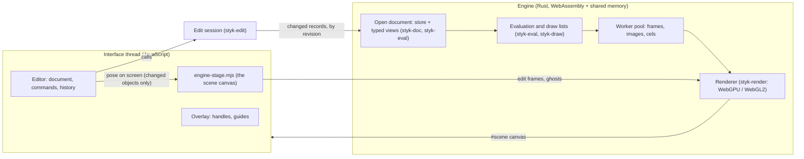

# Desktop architecture

StykAnimate separates the editable Pivot document, background work, and presentation. Changing the renderer or transport should not change file semantics or editor commands.

## Engine and interface (Rust port in progress)

StykAnimate is moving its engine from JavaScript and Python to Rust
(`engine/`, plan in [RUST-ENGINE-PORT.md](RUST-ENGINE-PORT.md), subsystem pages
in [engine/](engine/README.md)). The target: the engine owns the document and
everything between a file and pixels; JavaScript is the interface. Today the
engine opens every document and holds it, its edit session runs the commands it
has ported (the editor runs the rest on its read view and writes the result back),
and it draws every frame: no other renderer exists.

- File → pixels: the engine decodes the file on a worker (`styk-piv`,
  `styk-formats`), normalizes it as the editor's load does and holds it; the
  editor receives a read view of it, in slices; edit frames are drawn from the
  pose on screen; playback frames are evaluated and encoded on the engine's
  workers and presented by tick (`engine/document.md`).
- Boundary: commands go in; small results come out (frame metadata, statistics,
  the patch a command made to the read view). The whole document crosses once,
  when it opens.
- Threads: the interface thread never blocks on the engine; results carry the
  generation they were computed for and stale ones are dropped
  ([engine/threading.md](engine/threading.md)).
- Memory: the document exists twice (the editor's read view and the engine's
  store) until the interface reads engine queries instead of the read view
  ([D19](engine/decisions/0019-engine-owns-the-document.md)).

The sections below describe the JavaScript editor and services, which remain
the interface (and, for unported subsystems, the engine) during the port.

## Document and commands

`startup-document.mjs` supplies Blue for application startup and File → New. Camera, Scene and Layer 1 each contain one constant key at frame 1, held through frame 10. Blue is an ordinary 2D stick figure with ten named joints, a filled circular head, symmetric limbs and slightly bent elbows/knees. Four independent two-bone hand/foot IK controllers start enabled and unpinned, without stretching. `scripts/build-startup-blue.mjs` builds the native lines/circle and configures IK through the editor, generating a synchronous data factory; every new document owns independent editable data without rig setup at startup. STYK/STKZ retain the editable IK controls; Pivot STK/PIV retain ordinary 2D artwork and baked poses, without IK controllers. The Bubble helper and `demo.mjs` remain separate legacy tutorial/test fixtures.

Several projects can be open in one window; one is live in the editor and the others rest as detached editor sessions with their history. See [Project tabs](PROJECT-TABS.md).

The app opens on Home, a page over the workspace with the person's projects (the desktop's project list), Start and the tutorials; it holds no document and steps aside when one comes to the front. Tutorials run in the editor itself on a practice animation, their strip in the stage header. See [Home](HOME.md) and [Tutorials](TUTORIALS.md).

`editor.mjs` is the interface's view of the open document: its records as the engine session last published them, and the selection, playhead, active layer and layer focus the interface moves itself. Every edit is a call the session runs (`SESSION_COMMANDS` in `src/engine/engine-commands.mjs`); it works on native figure IDs, object UIDs, segment record order, joins, media tables and keyframes, records its history and answers with the patch the editor applies. Selection, editor visibility/locks, viewport transforms, and renderer caches are distinct from animation data. Shared definition edits propagate through instances and remain undoable. Rig topology traversals avoid recursive stack growth and repeated full-tree scans.

Build Figure presentation lives in `builder-mode.mjs`, `builder-outliner.mjs`, and `styles/legacy/30-builder-workspace.css`. The side toolbar retains its layout, with Chain pen beside Line; commands use the existing dispatcher. `builder-toolbar.mjs` owns the top bar’s native popover menus: bounded viewport placement, focus return, arrow navigation, type-ahead, and dismissal. Its session-scoped listeners are released on exit; commands continue through the existing delegated dispatcher. The bar exposes its part commands, including two direct flip buttons, and adapts labels to its available width; Test rig and Done sit in the top band, beside a quiet Export. Selection gating and checked menu states remain in the builder controller. `builder-context-menu.mjs` supplies joint, branch, fill and empty-canvas menus shared by canvas and hierarchy right-clicks; the controller bounds targets to the current session and routes fill/branch commands through existing editor methods. Context-menu pages reuse the app menu and restore focus to their source. Build hides the timeline by default; its footer toggle shows it, and the shell remembers the choice with Build's panel arrangement. The outliner is the Structure panel: the shell docks it and sets its width (232px, narrowing to 200px, then a strip whose button opens it as a sheet). The outliner uses iterative hierarchy traversal and fixed 30 px virtual rows, observes viewport resizing, and only replaces row markup when it changes. Canvas selection reveals collapsed ancestors; keyboard navigation and accessible tree state share the same row model. Drag exclusion covers the full descendant set, including malformed cycles.

The frame on show, its geometry (the groups the canvas, handles and pickers read) and the timeline come from the open document's engine session (`src/engine/engine-shown.mjs`, [evaluation.md](engine/evaluation.md#the-interfaces-frame)); the stage draws that frame inside the engine. The editor evaluates nothing: an editor the engine does not own has no frame, geometry or timeline, and `src/pivot/` holds what a document stores (validation, the timeline rows a document starts on, colour and flag words) and the background semantics. The frames around it, which the onion skins, the motion-path trails and the camera graphs sample, are the session's too ([evaluation.md](engine/evaluation.md#the-interfaces-views)). The session sends the groups of the figures that changed since the read the interface holds, so a chain of prior scenes is never retained. A live whole-figure drag retains its geometry and changes only per-object GPU translations; the model commits the final coordinates once. Joint/rig edits update affected objects and joined descendants.

Figure insertion, clipboard paste and decoded library drops share the range command planner. Validation and identity allocation finish before publication; undo retains inserted definitions and affected poses rather than the destination library. Published movieclip documents are immutable: clipboard/history copy the figure shell and retain that captured animation. Entering a clip clones its document; committing nested edits publishes a replacement. Imported external documents receive their own copy. Canvas pose commits retain the exact gesture preview when membership and playback settings are unchanged.

Movieclip presence clocks on ordinary layer sheets use a temporary projection containing only instance identities, playback descriptors and continuation records. The existing sheet sampler handles blank spans, remapped native time and frame replacements; the clock never interpolates unrelated joints or builds artwork. The engine derives the clocks from the stored spans (`styk_eval::records`).

Native connector and Smart Stretch relationships use the shared geometry evaluator,
an iterative cached dependency plan and sparse editor commands. Connector midpoint
positions reuse length channels; there is no second pose graph. Build Figure owns
setup UI and a detached pose tester. See [rig contracts and verification](RIG-CONSTRAINTS.md).

## Import and native codec

Electron reads selected source files through its isolated bridge. The Pivot codec, the Rust crate `engine/crates/styk-piv` compiled to WebAssembly, reads and writes PIV/STK files in a worker of the editor page on every platform; it answers what the original Python readers and writers (kept as its development test oracle) answered, replaying their recorded answers identically. Its modern reader bulk-reads numeric arrays and omits obsolete scalar-edit binding allocations. See [Pivot files and the codec service](engine/formats-piv.md).

The import worker reads the codec's responses and parses them. `document-transport.mjs` transfers bounded document fragments rather than cloning one entire expanded scene into the UI. Its default packet estimate is 256 KiB with a 3 ms preparation budget and receiver acknowledgments. Large strings, pose arrays and records are split; unknown fields and numeric values remain intact. The same transport supplies native document exports.

The codec's source/document cache has 24 entries and a 384 MiB budget on the desktop (160 MiB in the web build). Source imports are limited to 128 MiB (96 MiB on the web); decoded/native documents to 256 MiB (128 MiB). A native document is retained once because it already contains original source bytes. These are cache/input limits, not a promise that total application working set stays under those values. See [the codec's request contract](../backend/README.md).

## The stage and playback

`src/engine/engine-stage.mjs` is the engine's drawing of the scene canvas: edit frames (the
pose on screen, onion skins, the Draw view's turn and mirror), prepared playback frames by ticket,
the quality ladder's resolution and edge sampling, device loss and recovery. A frame the engine
cannot draw yet leaves the previous picture and is drawn again when it can be; a frame it refuses
is reported once and the document's next revision is tried afresh. If the engine or its graphics
device cannot start, the app shows a localized error. See
[Engine: rendering](engine/rendering.md#in-the-app) and
[threading](engine/threading.md).

`src/engine/engine-playback.mjs` is the transport's side of the engine: the document goes to the
engine once, ticks are requested from its worker threads, and a packet is a ticket for a frame the
engine has ready. `playback-budget.mjs` still defines the retention targets of the pixel caches the
interface keeps. The virtualized timeline draws visible exposures and labels, with a separate
playhead; the editor schedules rendering when state changes or playback runs, with no permanent idle
rendering loop. Advanced ruler scrubbing coalesces newer pointer positions to the latest requested
tick; the ruler displays the pending pointer target, release forces the exact final seek, and
inspector refreshes and thumbnail work wait until scrubbing finishes. See
[Adaptive preview memory](ADAPTIVE-PREVIEW.md) for source-image copies, cancellation, cache
allocations and remaining browser/format limits.

## Pictures outside the stage

Frame thumbnails, library previews, the camera monitor, the effects catalogue's
stills, the asset library's figure thumbnails, the background dialog's preview and the rig test's
pictures are all drawn by the Rust engine, never by JavaScript renderer code
(`src/engine/engine-thumbnails.mjs`, `src/engine/engine-previews.mjs`,
`src/engine/engine-pictures.mjs`; [engine rendering](engine/rendering.md#thumbnails-library-previews-and-the-camera-monitor)):
the stage's device or the preview worker draws them from the document the engine holds, or from a
small document the interface builds for one picture, and no document copy goes to a thumbnail worker.

Image-only preview workers use `image-resources.mjs` for encoded sources, crop
selection, decoded variants, byte accounting and disposal; image decoding does not
import the geometry evaluator or create rendering caches. Diagnostics retain one
completed image job, not a history of requests. `tests/image-resources.browser.mjs`
verifies decoding with the geometry module unavailable, exact pixels, reuse,
cancellation and residency.

The existing eight-request bound and filmstrip bitmap cache remain the owners of
queued thumbnails and displayed previews.

## Saving, recovery and exports

Audio has its own immutable document state, editor commands and bounded mixer
worker. Both timeline views share its clip UI; Web Audio schedules preview and
the existing FFmpeg service muxes an offline mix into video. Native project saving retains original audio bytes.
See [Audio architecture and verification](AUDIO.md) for timing, codecs and limits.

`DocumentExporter` receives the live report directly. Calling `editor.serialize()`, `structuredClone(report)`, or `JSON.stringify(report)` first would reintroduce a full UI pause. Bounded snapshots reach a dedicated worker, which normalizes the document, validates it, serializes it, and requests native output. Only derived keyframe-object `runtime_segments` caches are omitted. A revision change or active edit aborts the snapshot; recovery is rescheduled after the next idle period. Native STYK stores original source bytes and digest metadata so unchanged source export remains possible after a backend restart.

The worker returns a Blob. `native-files.mjs` writes or reads it through acknowledged 256 KiB IPC chunks, without whole-file ArrayBuffer/base64 conversion. Desktop main stages output and atomically replaces the destination only after completion. Cancellation preserves the previous file. Recovery uses the fixed desktop profile; browser recovery uses IndexedDB. See [document export contract](document-exports.md).

`src/engine/engine-export.mjs` gives every export the engine's renderer: a worker that joins the engine's shared memory and draws with its own GPU device (or the CPU rasterizer where it gets none), frames the stage would show, with the request, progress, revision, timeout and retry logic around it ([engine rendering: exports](engine/rendering.md#exports)). Current-frame images, sequences and videos use this shared path, including No smoothing, Smooth edges and supersampled Smooth sprites. SVG is the engine's too: the frame's draw list written as vector paths with embedded raster assets, or one embedded picture of the frame where it has no vector form (`styk-export` `svg`). Animation image compression, GIF quantization and ZIP assembly run in an encoding worker with one source frame in flight. Document replacement or cancellation stops the rendering job.

Desktop video streams PNG frames in acknowledged chunks to the bundled FFmpeg encoder. VP9 WebM preserves transparency; MP4/AVI/WMV use Pivot's black matte. The browser has opaque WebCodecs encoders with exact timestamps and local muxers: VP8/VP9 in WebM, and H.264 in MP4 (`mp4-muxer.mjs`) where the browser can encode it. Windows AVI can instead stream BGR24 to isolated 32-bit/64-bit helpers using genuine installed VFW compressors and their configuration dialogs. Capability probing describes the actual provider, codecs, alpha behavior and limits; no hosted encoder is required. See [export formats](EXPORT-FORMATS.md), [image exports](image-exports.md) and [installed Windows codecs](WINDOWS-CODECS.md).

## Workspace and desktop boundary

The top band holds the mark (whose menu holds the application menus), the open projects as tabs, the workspace switch, and undo/redo, Save and Export. The stage header (`src/shell/stage-head.mjs`), the
stage island's first row above `#viewport`, holds the location (the Scene with its size and background
colour) or the active tool's options, the one message, and the view toggles (joints, motion paths, grid,
effects preview; static handles and highlight part in Build), zoom and Fit. Nothing interactive sits inside
`#viewport`.
Figure effects can isolate joined descendants through a render-only container;
see [Effects and connected figures](VFX.md) for scope, draw-order and timing rules.
The left tool rail has a divided stacking group: normal clicks move to front/back,
and Shift-click moves one step. These use the existing selection-order command.
Normal right-click opens a short menu for the hit figure or an empty-stage menu;
clicking a selected figure preserves multi-selection. More figure actions holds
less frequent commands. Shift + right-drag retains joint bending; Held R handle
editing can use the same modified secondary gesture. Escape closes menus and
returns focus, and pointer-down outside dismisses them before another gesture.

Custom HTML/CSS provides compact editable controls, native keyboard/text behavior and a consistent neutral palette. The animation scene uses the custom GPU canvas.

The shell (`src/shell/`) lays the editor out as islands on the window's field: the tool rail centered vertically inside the stage, an optional left dock (Build's Structure), the stage island (the stage header and `#viewport`), the right dock (the Properties, VFX and Library tabs) and the timeline island under them (full width by default). `panel-registry.mjs` describes the panels, `layout-schema.mjs` stores each workspace's arrangement (the rail left or right, the timeline full width or under the stage, and each panel docked on a side, folded to a strip, floating (Properties, VFX, Library and Build's Structure) or hidden), its saved layouts and the shared sizes (schema v2, with a v1 mirror that 1.1 reads), `layout-solver.mjs` fits a layout into the window (width and height tiers, the default timeline height, #viewport's 360×200 minimum and the stage insets `fittedView()` uses), and `layout-store.mjs` loads it before the first layout and saves it debounced and merge-on-write through the workspace preferences IPC (localStorage in the browser). The top band holds three clusters: the mark and the open projects as tabs (each with its picture, its name and its state; see [Project tabs](PROJECT-TABS.md)), the workspace switch, and Undo, Redo, Save and Export. The menubar stays in the markup as the source of the mark's menus and never shows. In a session (Build, a movieclip being edited, the Camera selected) `topbar.mjs`'s `syncBandSession` shows that session's buttons (Build's Test rig, a movieclip's Cancel, and the session's Done) and turns the one Export into a quiet button beside Done. The rail (`rail.mjs`) shows only the current workspace's tools, centered beside the canvas in every workspace; Animate's + opens the Add menu (a stick figure, text, an image, figures from a file, a movieclip, another copy of a figure in the project, the examples), Draw's + makes a drawing layer, and a tool with variants (Select pixels, Shapes, Draw's +, the Tweener) lists them from its corner tick. `topbar.mjs` also measures the band's width after each of its fold steps whenever its content changes; the solver folds the band's words and spacing first (the primary's word last) and folds the menubar into the StykAnimate menu only where even the last step does not fit (the minimal width tier). `dock-host.mjs` applies each solution in one commit and is the only module that shows or hides a panel: feature modules hear `onVisibility` (the VFX rows in the Advanced timeline follow the VFX panel's visibility). At compact width the band's Properties button opens the inspector as a sheet, a folded side is a strip whose icons open sheets, and at the low height tier the timeline is its header and Timeline… opens its body as a sheet; panel roots keep their place in the DOM while a sheet shows them. Fitting a layout into a small window never rewrites it. `window.styk.workspace` exposes sizes, the stored preferences, presets, docking, floating and Focus; `flushPreferences()` lets close and tests await the last write. `dock-keyboard.mjs` adds F6 region cycling and the keyboard panel move, `dock-tabs.mjs` makes the tabs (and strip icons) the panels' handles: drag one to dock or float the panel at the one drop target under the pointer, or open its menu to dock, float, fold or hide it. Dragging into the canvas floats without a modifier; Shift keeps floating near a dock. Drops above or below a dock's content split it into two islands, whose divider resizes their stored shares. Dropping on a tab row merges panels. Structure retains a visible tab as its drag handle. The tool palette's grip moves it between the stage's sides (also Left/Right keys), retaining vertical centering. These gestures use the same per-workspace arrangement and saved presets; no panel roots or document data are copied. `layout-popover.mjs` is View › Layout… (Ctrl+Alt+L): the workspace's presets as dock maps, saved presets (rename, update, delete), one position per panel, Reset and Save as preset…. Each of them only calls the workspace API, so they cannot disagree. `shell-commands.mjs` registers the shell's commands in the `actions` map.

`src/app.mjs` wires the editor, the engine's stage and the panels together. The panels' own handling lives beside it in modules that app.mjs calls with a context object (`{editor, state, …}`, getters for what it creates later): `inspector-bindings.mjs` maps each inspector control to the editor command its change applies, in order, so the first binding whose selector matches takes the change (a Build-only control passes it on outside Build). `timeline-host.mjs` is the one place that constructs the Simple or Advanced timeline (`mount()`, with the app's scrub, range and history callbacks), wires the timeline header's own controls (the Simple │ Advanced switch, the frame rate, the zoom) and writes what the header shows: the transport readouts, the play button's state, Edit selected frames and the pressed mode. `export-flow.mjs` owns exporting: every export command (registered in `actions` before app.mjs wraps them), the export renderer's job and writing the result. Each export runs from one explicit request (`export-request.mjs`): `exportJob()` derives the size, range, quality, codec, sound and file name the encoders receive. The export dialog (`export-sheet.mjs`, its own kit dialog) holds the request, previews the animation through the thumbnail renderer (the engine's where it draws the document) while it is open, runs the chosen type's command and shows its progress in place; a command run without it (the command palette) exports today's defaults, with its progress in a dialog of its own. Its choices persist in the `exportPreferences` editor setting. `app-dialogs.mjs` holds the app's own prompts, each its own dialog from the kit (`src/ui/ui-dialog.mjs`): Save changes?, the project's name, Recent files, Performance, the import notes, the Stick Nodes pack picker and Discard frame changes?. `index.html` gives the header static slots, `[data-slot=start]`, `[data-slot=transport]` and `[data-slot=end]` (the three clusters) and `[data-slot=ruler-tools]`, which hold today's controls and take no box of their own until the shared header lays them out. The chrome updates by surface (`src/ui/ui-invalidation.mjs`): app.mjs declares the title, the transport, the layers, VFX, the inspector, Edit selected frames and the stage hint, the status readouts, the Add dialog's lists and the shell, each with the reasons that make it stale. `queueUI()` marks them all and one pass a frame updates what is marked, in that order; `updateUI()` updates every surface at once (startup, a restored document). Playback stays quiet: while playing only the transport updates, at most every 200 ms (the readout at 5 Hz), and the title, which writes only when the name or saved state changes; the playheads move on their own, and every other surface waits for the first pass after playback stops. The canvas repaints after a pass only when the pass updated a surface and nothing is playing, so a surface waiting for its time costs no redraws and playback draws each animation frame once. Playback shows prepared frames only (the stage's editing view is unclipped and would blink at the artboard's edge): a frame the engine cannot give at once leaves the picture on show and is drawn on the next animation frame. Surfaces and the modules that follow every editor change (the onion controls, the canvas guides, the Library's save button, the session breadcrumb, the timeline host) write through `src/ui/dom-write.mjs`, which compares with the element's current value first, so an unchanged value writes nothing. `tests/playback-quiet.browser.mjs` holds playback to this, with a ratchet of the known remaining writers and their milestones. The stage header (`.stage-head`, the stage island's first row above `#viewport`) is `src/shell/stage-head.mjs`: its start (`[data-slot=stage-start]`) shows the location crumb, or the active tool's options (a bar rendered by `src/ui/tool-options.mjs` from the tool's option descriptors, or a host it adopts until its tool has them: Draw's quick bar, the chain and polygon controls); its end (`[data-slot=stage-end]`) holds the view toggles, re-parented with their ids, then zoom and Fit; and it places the one message (`src/ui/ui-toast.mjs`'s `#toast` host, in the top layer) over its centre, covering the start while it shows but never the view cluster, or on a line of its own under the header when its whole text does not fit there. It shows a pick mode's instruction while the mode lasts (Join, Connect joints, image and copy placement, Chain, Polygon, the Tweener) and a quiet "Slow · N of M fps" while playback misses its target, read at most once a second. app.mjs updates it as the `stagehead` surface, and at once when a workspace or a view toggle changes. `index.html` keeps static hosts for the inspector's header too: the target (`[data-slot=inspector-target]`, with `#inspector-context` and `#object-actions`) and, under it, the host of the scope line and the quick actions row (`[data-slot=inspector-head]`).

Editor styles load through `src/styles/app.css`, the only stylesheet `index.html` links. It declares the cascade layers and imports every sheet in cascade order; see [Design system](DESIGN-SYSTEM.md). Modules do not link stylesheets at runtime, except that the desktop feedback shell links `src/styles/support-bridge.css` when Feedback first opens, so the website's shared `src/support-center.css` loads only when needed; `src/styles/features/support-desktop.css` restyles it for the editor from the `features` layer. `npm run check` enforces this and the layer rules with `scripts/check-css.mjs`. Colours, type and spacing come from `src/styles/tokens.css`, the StykAnimate brand tokens for the light and dark themes; `src/styles/legacy-bridge.css` points the older `--theme-*` names at them. The UI fonts ship in `assets/fonts/` and load through `src/styles/base/fonts.css`.

Electron uses context isolation, sandboxed renderer code, and no renderer Node globals. Native IPC exposes specific file/stream/window/preference operations, not arbitrary filesystem commands. Workspace preferences live in a fixed, atomically written user-data JSON file capped at 16 KiB. They and recovery survive a restarted process.

`desktop/web-host.cjs` owns the desktop's origin: the privileged `styk-app://app` scheme, which the main
process answers itself from the web assets, read-only, cross-origin isolated (no sockets, so no connection
limit while hundreds of modules load, and the same origin on every launch, which keeps V8's code cache
between launches). `npm run serve` and the browser tests use the same assets through a loopback HTTP host. Pivot and STK files are read and written by the Pivot codec,
`engine/crates/styk-piv` compiled to WebAssembly, in a worker of the editor page on every
platform, desktop, development server and web build alike
([Pivot files and the codec service](engine/formats-piv.md)). Import and export workers reach it
over a MessagePort per job with the request contract of the former HTTP service
(`codec-request.mjs`); its queue (`codec-web-shell.mjs`) runs one request at a time. Import/export
controllers own an opaque job identity and cancel independently of their worker: on a
cross-origin isolated page a shared flag stops the running request at the codec's next
cooperative checkpoint (decode, validation, fingerprint and writer loops) and the worker keeps
its cache; elsewhere the busy codec worker is stopped. A codec failure leaves WebGPU editing,
Undo/Redo, native project saving and local native reopening available; the next request starts
a fresh codec. The desktop's sample list comes from the main process (`desktop/samples.cjs`).
The Python codec (`codecs/`, `backend/`) is kept only as the codec's development test oracle,
and the app, desktop or web, contains and starts no Python (Python remains in development for
the packaging scripts that stage the video encoder and build the Windows codec helpers); see [Web build](WEB.md) for the web profile's limits. On phones and
tablets the same editor runs its touch interface (`src/touch/`), which re-arranges the shell and
turns fingers into the desktop's pointer events; see [Touch interface](TOUCH.md).

Windows and Linux source execution and packaged builds are verified; CI builds, packages and boots the Linux AppImage, and runs the unit suite on both ([Linux support](LINUX.md)). A distributable includes the current web assets (the engine and codec WebAssembly modules among them), the video encoder and licenses. Rebuild and verify the package after source changes; earlier smoke reports do not certify newer bytes. macOS has a build target that has not been executed. Platform-specific behaviour lives in the owning layer: Chromium's GPU switches in `desktop/gpu-switches.cjs`, interpreter discovery for the packaging scripts in `scripts/run-python.mjs`.

## Canvas guides and grid

`src/canvas-guides.mjs` owns a fixed-size DOM overlay and a popover. It does not
modify document poses, history, renderer caches or export surfaces. The vertical
X and horizontal Y guides have independent visibility, scene-pixel inputs,
edge-handle dragging, arrow-key nudges (Shift: 10 pixels), Escape cancellation,
and a shared lock. Positions are clamped to the scene and stored as proportions
in editor preferences, so they adapt when a different canvas size is loaded;
these are workspace aids rather than per-project animation data. Numeric fields
reuse `PropertyControls` for drag adjustment (Shift/Alt for finer steps), direct
typing and Escape rollback. Live previews stay local; release commits preferences.

The grid clips to the visible stage and uses CSS gradients. Its configured cell
size stays in scene pixels; at low zoom the displayed step doubles until at least
eight screen pixels apart. Rendering uses a constant number of DOM elements,
skips inactive aids, and skips unchanged layout writes. Aids hide during playback
and preview. Grid spacing, opacity, guide visibility, positions and locking use
the existing normalized settings persistence. Guide edits do not dirty projects.
See `tests/canvas-guides.browser.mjs` for UI verification.

## Reproducible evidence

| Concern | Command | Report |
| --- | --- | --- |
| Source-bearing save/restart/export | `node tests/document-export-browser.mjs "path/to/project.piv"` | `artifacts/document-export-browser*.json` |
| Exact native file streaming | `npm run test:streams:desktop` | `artifacts/native-streams-smoke.json` |
| Workspace process restart | `npm run test:preferences:desktop` | `artifacts/desktop-preferences-smoke.json` |
| Editor UI screenshots and pixel diffs | `node scripts/ui-snapshots.mjs --url <server> --label <name> [--compare <label>]` | `artifacts/ui-redesign/snapshots/<name>/` |

The UI tests use the local development server; profile scripts accept `STYK_URL`. Artifacts name the fixture, phase, timing scope, and observed limitations. Long-task absence, total job duration, CPU submission, GPU completion, and display latency are separate measurements.

## Interface scale and settings

Settings → Animation → Playback includes “Fit view when playback starts”, enabled
by default. Disabling it preserves the current canvas zoom and pan on transport
start. The preference persists through the existing editor settings store.

`src/ui-scale.mjs` owns the 75%–200% presentation range, five-percent steps,
normalization, and application through the narrow desktop `setUIScale` preload
API. `EditorSettings` persists `uiScale` through the existing editor preferences
store and reapplies it at startup. Old or invalid preferences default to 100%.
Electron uses native page zoom so layout, pointer coordinates, viewport sizing,
and device-pixel ratio stay in the same coordinate system. No document data,
canvas view scale, undo history, or export dimensions are changed.

The browser preview keeps browser-native zoom controls; it does not substitute
CSS transforms that would desynchronize interactive editor coordinates.
`src/styles/features/settings.css` owns the Settings presentation: the head
with its search, the sidebar of sections, each page's titled cards, the
shortcut editor and the Feedback page. It sizes everything from container
queries on the dialog and its content pane, so the sidebar becomes a strip of
tabs in a narrow dialog. Native slider keyboard behavior, labeled outputs, tab
navigation, and Escape dismissal are preserved. Verify with
`node --test tests/ui-scale.test.mjs` and `node tests/settings-scale.desktop.mjs`
(isolated profile, process restart, canvas pointer alignment, light/dark and
compact screenshots).

Neither `EditorSettings` nor `HotkeySettings` injects CSS. `EditorSettings`
builds every row from the same few builders (a switch, a select, a block row)
inside titled cards, and takes its words from the localization, falling back to
English in `src/locales/en-dialogs.mjs`. The search in its head renders the
Interface, Canvas and Animation sections together and keeps the rows whose
words match; the rows are the tabs' own markup, so a result changes its setting
as in its tab, and Escape clears the search before it closes Settings.
Shortcut state and binding validation stay in `hotkey-settings.mjs` /
`hotkeys.mjs`, with persistence owned by `EditorSettings`. The Feedback page's
tiles forward their category to the shared `FeedbackUI` draft and *My reports*
opens its inbox; the sidebar Donate action uses the existing `openDonate`
desktop bridge. Neither is part of tab navigation. `FeedbackUI` applies only the
newest open's options once the support center has started, so reopening with
another type while the first open is still loading never ends on the older one.
`node tests/settings.component.browser.mjs` covers the rows and the search;
`node tests/settings-tabs.desktop.mjs` verifies shortcut editing, canvas
controls, feedback categories and the inbox, the donation callback, and
responsive light/dark layouts without submitting feedback or visiting payment
pages.

### Construction gestures

`builder-construction.mjs` owns the transient chain draft and a figure-scoped spatial index. Joint and sampled-midpoint candidates use a balanced k-d tree; sorted coordinate/length tables supply axis and equal-length targets. Tolerance stays in screen pixels, with point hysteresis and an Alt bypass. Rig gestures snapshot the index once and exclude the edited branch. Snapping changes position, not connectivity: starting at a native joint attaches the new branch; snapping an endpoint onto another joint does not weld handles or introduce cycles.

New builder segments inherit colour and thickness from their native parent handle, including per-instance style edits; explicit thickness arguments take precedence. Chain links carry these values forward. Origin-attached segments retain the default thickness of 8 and the figure's first segment colour (new figures use purple).

Drawing previews snapshot inherited colour and world-space width at gesture start and scale with canvas zoom; zero-width construction lines retain a thin guide. Builder Edit and joint context menus copy the primary selected joint’s displayed paint (including gradients and opacity) and thickness into an app-local clipboard. Paste reuses the existing selection/branch style command as one undo step, preserving topology, shape, rig properties and draw order. Explicit multi-selection targets only those joints.

The chain pen creates no document commands while clicking. Enter, double-click or Finish calls `Editor.addSegments` once. Backspace removes the last point; Escape, tool/session changes, external document edits and the chain context menu cancel the draft. Preview paths rebuild only when points or zoom change. The persisted `builderSmartSnapping` preference is UI state, absent from exported artwork.

Append and rig commands use sparse definition snapshots: history contains appended records or explicitly changed segment indices, plus the existing affected source-pose journal. Unchanged segment references exist only during the synchronous command and never enter its history payload. Origin-support figures retain the full topology repair path. New-figure creation journals a definition splice rather than copying the complete definition table. Geometry invalidation retains unrelated objects while rebuilding every instance and joined dependent of the edited definition; IK, movieclip and slot-remapping cases retain conservative invalidation.

`builder-duplicate-preview.mjs` caches a high-contrast branch silhouette, including circle and polygon fills, in one bitmap capped at 2048 × 2048 pixels. Pointer movement translates the bitmap and queries its joint index. Placement preserves the existing duplicate command's native topology and undo behavior; cancellation drops the bitmap and index.

Builder node selection uses transient native handle IDs scoped to one object UID; Shift-click toggles those IDs in the canvas and hierarchy. Explicit multi-selection style edits target exactly those segments, with a single undo entry; single-node branch editing retains its existing scope. Builder Delete dispatches to segment/branch or selected-fill commands even under Select, so it cannot accidentally remove and recreate the session object. Selection is restored with command history and does not enter the saved figure format.

`builder-fill.mjs` caches directed-edge region discovery by evaluated geometry in a WeakMap. Polyfill Shift-click uses closed line/curve outlines whose native endpoints coincide; dangling strokes are removed from face discovery. Crossings without joints do not create boundary connections, and compound holes are not generated. A preview shows the exact proposed region before committing one native `addPolygon` command. Direct interior clicks select the topmost visible fill in the builder figure, with joints taking precedence; fill color, opacity, order and deletion reuse the existing polygon commands.

## Raster drawing integration

Drawing layers use the ordinary layer-sheet and image-figure contracts.
`editor-drawing.mjs` reads the cel being drawn on and the commands are the engine session's (`engine-owner-drawing.mjs` applies the pixels around them); `drawing-resources.mjs` owns transient
surfaces and worker publication; `drawing-controller.mjs` owns pointer gestures.
`drawing-view.mjs` extends the shared inspector primitives and tool rail.
Pixel history participates in the existing command stream and its shared
undo/redo byte budget. See [drawing ownership and workflow](DRAWING.md).

## Interface localization

`src/localization.mjs` is the one DOM-free lookup/fallback and Intl formatting
service. English messages have exclusive feature ownership; independent JSON packs
supply locale metadata and translations. `src/localization-bindings.mjs` connects
presentation keys explicitly at UI owners and updates retained captions/attributes
on language changes. Numeric drafts, editor documents, command IDs/history, canvas
coordinates and chronological timeline order do not depend on locale. Worker errors
retain diagnostic identity and transfer message metadata through existing replies;
Electron shares the catalog/service through its native facade and existing settings
IPC. Generated registry/context/preload blocks belong to integration, not individual
translators. [LOCALIZATION.md](LOCALIZATION.md) defines the lookup, variant, plural,
RTL and validation contracts; [TRANSLATING.md](TRANSLATING.md) defines pack ownership.
