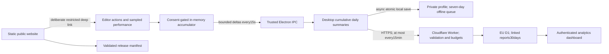

# StykAnimate profiling and analytics

The desktop collector, Cloudflare service and private dashboard use one versioned allowlist: `src/telemetry-schema.mjs`. There are no third-party analytics SDKs, session replay, advertising identifiers or paid analytics subscriptions.

## Architecture

Foreground playback retains the legacy interval-overrun counter for historical continuity. It can count normal 24 FPS / 60 Hz cadence mismatch. The separate `playback_lateness` metric measures render submission after the scheduled frame deadline, subtracting one observed display callback interval; its missed count uses an additional 10% of the project frame interval as tolerance. A fixed 32-sample callback buffer is observed from the existing loop only with diagnostics consent, excludes pauses, and resets on playback start/background. This is scheduling evidence, not monitor presentation time; initial callbacks without a cadence estimate are excluded. Known recoverable command preconditions use `UserActionError`, remain visible to users, and do not generate failure incidents. A propagated error object generates one incident.



`src/telemetry-core.mjs` counts and aggregates in constant, bounded memory. It creates no extra animation loop. CPU submission timings are sampled once per30 rendered frames. A15-second activity sampler runs only with consent; it records an activity timestamp, never a key or pointer value. PerformanceObserver collects long tasks and slow input events only with diagnostics consent. `src/telemetry-measurements.mjs` groups observed interaction IDs in memory and distinguishes foreground playback from discontinuities. Neither module retains event targets or text; interaction IDs never enter a report.

`desktop/telemetry.cjs` owns the private random32-byte installation token, hashes it for report identity, revalidates IPC and merges deltas. It saves locally outside the render path, batches uploads, respects Retry-After, aborts pending uploads on withdrawal, keeps at most seven days of unsent summaries, and retries requested deletion. Disabled reporting has no sampling, upload or persistence timer. An acknowledged baseline for today prevents a same-day opt-out/re-opt-in from reducing previously accepted totals. Local first-observed milestones and coarse first-success results survive a longer absence. Release, build and traffic classification come from the trusted desktop process; renderer IPC cannot replace them.

The website's Cloudflare Worker enforces the same schema, derives identity from the bearer token, stores one cumulative installation/day snapshot with a monotonic sequence, and makes retries idempotent. The database never stores the private token. It rejects arbitrary fields, oversized JSON, invalid dates/metrics and deleted identities. A30-day hash-only deletion marker prevents delayed uploads from recreating erased reports.

The public website, configuration and release manifest are static assets: normal visits execute no Worker code and access no D1 data. Only telemetry, feedback and administrator routes run Worker-first; unknown API routes return a Worker 404. Public pages contain no tracking code or third-party font requests. The dashboard uses a private server session in an HttpOnly cookie, same-origin mutation checks, login rate limits and no credentials in its client JavaScript. Secrets must never be placed in `desktop/service-config.json` or public assets.

Unchanged reports are not uploaded. Idle-only changes wait for the next useful report, and leaving the app idle across midnight does not create an idle-only installation-day. Resource sampling runs only while the app is foregrounded. Memory, file persistence and networking stay outside the renderer's frame path. A deliberate manual sync can upload deferred data immediately.

## Collection and metric interpretation

All currently supported counters, timings, maxima and dimensions are visible in the dashboard. A missing diagnostic is missing data, not a measured zero. Daily installation summaries identify installations, not people; opt-out users cannot be counted.

| Category | What it measures | Important interpretation |
| --- | --- | --- |
| Product | Sessions observed, active/idle seconds, timeline-mode seconds, edit notifications, first observed launch/edit/save/export dates, time-to-first-success buckets | Active means focused and foreground with input in the last60seconds or playback running; short intervals and sleep are clamped. Idle-only reports are deferred. First launch means first launch observed after consent. First-success duration is elapsed wall-clock time from that observation, including inactive/offline time. |
| Features | Open/new, undo/redo, clipboard, duplicate/delete, keyframe, onion, camera, builder, IK controls, library and movieclip commands | Counts instrumented command attempts or committed edit notifications, not every mouse gesture. Cancelled edits can emit edit notifications. Never infer unique documents from these counters. |
| File operations | Start/success/failure/cancellation, broad import/export format families, contextual duration histograms by stage and outcome | A command’s format counter is an attempt; use successful operation totals to judge completion. Import batches count as one top-level operation; per-file context rows describe individual files. A decode and a complete row can describe the same file, so do not sum stages as distinct attempts. |
| Timings | Startup, imports/decoder, serialization, exports, recovery, frame submissions, slow input, long tasks, playback startup/intervals/buffering | Save/recovery/native-export timing measures serialization; render export timing ends before the save dialog. Import includes any confirmation delay. Frame timing is CPU submission time, not measured GPU execution. |
| Playback | Starts, elapsed playback seconds, presented frames, buffering events/time, streaming foreground interval histograms, observed intervals and missed deadlines | Version2 records actual scene presentation intervals without retaining a presentation history or creating another animation loop. Deadlines use the project's target FPS with10% scheduling tolerance. Background spans and discontinuities are separate. This is not a measurement of GPU completion or monitor display timing. |
| Resources | Once-per-minute aggregate Electron CPU and working set; sampled JS heap and renderer GPU allocation/draw/upload/object/primitive peaks | Peaks are maxima of samples, not continuous maxima. GPU allocation is the renderer’s tracked allocation, not total GPU memory. Electron process totals exclude the Python sidecar. |
| Compatibility | App release/channel, build fingerprint, external/internal/mixed/unknown traffic, broad OS/version/architecture, RAM/CPU buckets, coarse GPU vendor, rendering availability, language and latest timeline mode | No exact device model, hardware serial, display resolution or location. Mixed release/mode days belong to the latest snapshot; mode filters select whole days with observed mode use. Release/build labels on a day spanning an upgrade do not prove every earlier observation came from that build. Traffic classifications are conservative; see migration notes below. |
| Reliability | Caught/unhandled JavaScript errors, renderer exits/hangs, backend errors, GPU loss, prior unclean termination | Allowlisted error type, operation, safe error code, stage, format/complexity buckets, source module/line and hash; no raw messages, arguments or paths. An unclean exit may be a power loss or forced quit. No automatic full native crash dumps. |
| Feedback | Category, explicitly submitted message, release and platform, deletion identity | Separate from profiling consent; sent only by the form action. No automatic attachment. Contact is the published support email. |

Histograms use fixed upper bounds from1ms to one hour. p50/p95 are approximate bucket upper bounds capped by observed maximum. Out-of-range values are dropped. Error groups are capped at20per local day and are deduplicated when the same Error reaches multiple handlers. Network failure does not interrupt editing; the last15seconds of renderer deltas or60seconds of unpersisted main-process data may be lost on a sudden crash.

## Version2 measurements and compatibility

The shared schema accepts both versions1 and2. Older queued days remain version1; a version2 client upgrades its current day while preserving cumulative counters and legacy histograms. Existing uploads and historical measurements are not rewritten. Corrected measurements use separate keys: `interaction_ms` and its phases replace new writes to `input_latency_ms`, while `playback_foreground_interval_ms` replaces new writes to `playback_interval_ms`. The old keys remain available as legacy evidence. A current day upgraded partway through can still contain legacy recovery failures, so an unqualified whole-day recovery success rate would be misleading.

Slow input observations request a40ms browser reporting threshold. At most64pending interaction IDs and128recent IDs are held in memory to combine entries for the same interaction; observer batches are capped at100entries. Histograms contain one maximum observed duration per grouped interaction, plus input delay, processing and presentation phases when coherent timestamps exist. These are diagnostics for reported slow interactions, not INP and not a denominator for all user interactions. Regular foreground observations are limited to60seconds. Background, unattributed, dropped and discontinuous observations have separate counters. Long or suspicious spans that fit the one-hour transport bound are retained in anomaly histograms, keeping them out of regular responsiveness averages. Values beyond that bound can still increment the discontinuity counter without contributing an unbounded duration.

`operationContexts` retains at most12combinations per installation-day. Failed operations have priority over cancellations, successful file operations, and playback intervals, in that order; complete attempts take precedence within a category. New higher-priority combinations replace the lowest-priority retained combination. Identical combinations merge into duration histograms; rejected and displaced timing samples increment `dropped_operation_contexts`. This rule runs at both renderer and desktop aggregation boundaries. The fixed dimensions are operation, stage, format family, file-size bucket, complexity bucket, target-FPS bucket and outcome. This bounded sample describes covered contexts and must not be presented as complete coverage when drops are nonzero. File-size buckets are under1MiB,1–10MiB,10–50MiB and50MiB-plus. Complexity uses an estimate of authored segments in the first frame, grouped as under100,100–999,1,000–9,999 and10,000-plus; bounded traversal stops after2,048entities and larger definition tables produce unknown. It is neither a document fingerprint nor an exact renderer workload. FPS buckets are up to24,25–30,31–60 and over60. Unknown is explicit when a dimension is unavailable. No filenames, exact file sizes or document contents enter this context.

Import, document-export and frame-export workers forward allowlisted error types, codes, stages, and up to five module-basename/line pairs. No raw stacks are forwarded for telemetry. Memory-budget failures map to `out_of_memory`, lost export canvases to `device_lost`, and worker timeouts to `timeout`. Camera, VFX, geometry, native-file-codec and export-rendering modules are included in the source allowlist. Deploy the updated shared schema to the collector before distributing a desktop build that reports these new module names; an older collector can reject otherwise valid new reports. The schema version and report size ceiling remain unchanged, and historical unknown errors cannot be retroactively assigned a cause.

`firstSuccess.save` and `firstSuccess.export` contain one of six coarse elapsed-time buckets: under1minute,1–5minutes,5–30minutes,30minutes–2hours,2–24hours and over24hours. A new consented first-launch timestamp is persisted locally; it never appears in preview or uploads. Renderer milestone delivery can add up to the15-second batch interval. Existing installations without that original timestamp remain unmeasured; upgrades never fabricate a start time. Withdrawing analytics clears the local timestamp and unsent first-success results, and deleting data removes them. Restoring already acknowledged same-day totals does not begin an invented replacement timer.

Context timing stages have specific boundaries: save/recovery `serialize` covers producing the output Blob through the document worker and local backend; raster/video `encode` covers job preparation, rendering and encoding until that Blob is ready. `write` includes any save-dialog wait and the file transfer. `complete` measures the whole attempt, including user confirmation time, so it is not a disk-speed or pure CPU metric. Desktop success requires the file writer to finish. Browser recovery success requires IndexedDB transaction completion; an ordinary browser download can only confirm handing the file to the browser. Playback contexts marked `succeeded` represent observed presentation intervals, not completed export-style operations.

Unpackaged development runs are internal. A trusted packaged test-build setting can also classify a build as internal. Ordinary packaged builds are external; switching between internal and external activity in one day produces mixed, which remains mixed for that day. Older beta records lack reliable provenance and remain unknown on a same-day upgrade. Metadata updates keep the latest release/channel/build without falsely converting prior internal or unknown activity into external beta usage. These labels distinguish execution settings, not verified people; manually testing an ordinary public build remains external unless the trusted internal setting is supplied.

Packaging runs `scripts/build-telemetry-info.cjs` through `before-pack.cjs` to create the ignored `desktop/telemetry-build.json`. Its deterministic source fingerprint identifies code, never an installation or document. Set `STYK_INTERNAL_BUILD=1` only when packaging a test build; normal release builds should omit it. The main process supplies this metadata and rejects renderer overrides.

All additions use the existing consent categories,32KiB report ceiling, seven-day local queue and15-minute upload schedule. Cumulative histograms and counts are bounded at the privileged boundary, and saturation or context overflow is counted. No new automatic raw traces, replay, paid service or extra upload cadence is introduced.

Activation and repeat-creation metrics disclose their eligible populations and observation windows in the dashboard. Today is incomplete. Offline delivery, consent, deletion, rate limits, seven-day local expiry and30-day server retention bias estimates. Do not present participation metrics as the total audience or a crash-free-session percentage.

## Version 3 performance diagnostics

Schema 3 accepts older schema 1/2 queues unchanged. New desktop reports add a separate `performance` section and `diagnosticGeneration`; legacy histogram boundaries and meanings are preserved. `src/telemetry-performance-schema.mjs` owns the fixed metric/context allowlist, finer timing and resource buckets, merging, validation, and budgets. `src/telemetry-performance.mjs` owns renderer sampling and lifecycle state. Engines receive an optional diagnostic observer rather than importing the desktop collector. No observer traverses, copies, serializes or retains a document.

| Measurement | Boundary and interpretation |
| --- | --- |
| Render stages | Independent 1/30 frame sampling records frame/scene totals and available geometry, preparation, submission, overlay, camera and VFX spans. Geometry/editable preparation includes existing yielding work. Parent spans include child stages; do not sum overlapping durations. |
| Editing actions | Independent 1/8 sampling includes fast and slow instrumented commands, drag updates, seek notifications and wheel pan/zoom. Duration ends at the next completed editor render submission. Seek begins at the editor notification; this excludes earlier seek processing. These are submission proxies, not INP or monitor scanout times. Eligibility, selected samples and unpresented actions are counted. At most eight actions wait for a frame, and focus boundaries discard pending observations. |
| Worker preparation | Independent 1/30 playback requests retain local start time and coarse context. The worker supplies queue and computation durations from its own clock. Roundtrip minus those spans is message transfer/delivery/handling overhead, not pure memory-copy time. No subtraction of clocks from different processes. Superseded requests produce no completed sample. |
| GPU | Optional timestamp queries measure the base editor/prepared render pass; later VFX passes and presentation are excluded. Only one 16-byte readback is in flight. Results are read asynchronously, without waiting on GPU completion in the frame loop. Unsupported optional device features fall back to normal device creation. Consent generation prevents delayed results crossing withdrawal. |
| File work | Import decode and export serialization/encoding spans supplement legacy contexts. Native writes separate destination setup/dialog wait from transfer and commit. Streamed export writes sum time spent awaiting file IPC, including patches and commit; encode totals may overlap these writes. Cancellation and failures remain separate operation outcomes. |
| Memory and caches | Samples of JS heap, tracked GPU and playback-cache MiB at before-open/opened/stopped/closed boundaries and periodic foreground sampling. Closed is replacing the project with a blank document; idle samples follow after 15 seconds. Electron working set and local Python working set are sampled once per minute; backend RSS is available on Windows/Linux, missing elsewhere. Cache hits/misses/evictions are deltas between samplings. Peaks alone cannot prove a leak. |
| Recovery and quality | GPU, camera, VFX and import/playback worker interruptions record start and recovered/failed/unresolved outcomes and elapsed time. An orderly renderer shutdown closes outstanding recoveries as unresolved; a sudden exit can leave only a start. Reduced preview duration covers consecutive foreground observation windows, capped at 15 seconds per sample. |
| Browser stalls | Feature-detected Long Animation Frames record total/script/layout time. Script attribution is reduced to a fixed module family; URLs, function names and invokers are discarded. It does not attribute workers or GPU execution. Context is the coarse state at observer delivery. |

Each performance group carries its own fixed workload dimensions and trusted main-process release/build/traffic and RAM/CPU/GPU buckets. Workload uses the renderer's current primitive count, target-FPS bucket, viewport pixel bucket, phase, quality and five feature bits (onion, camera monitor, VFX enabled, motion paths, textured objects). These are coarse diagnostics, not device/document fingerprints or counts of people. Error and operation-context groups also retain observation provenance; upgraded historical groups remain unknown rather than being reassigned to the new build.

The renderer and desktop cap performance groups at 48, with per-family caps and a 16 KiB diagnostic budget within the existing 32 KiB report ceiling. Lifecycle memory and recovery outcomes take precedence over routine stage samples. Rejected/evicted groups are counted. The three largest severe incident summaries retain allowlisted numeric stage costs and up to four preceding sampled frame tuples (CPU ms, pending worker frames, tracked GPU MiB), never animation frames or recordings. Observer arrays and pending interaction/worker work remain bounded. No added upload cadence, profiling timer, raw trace upload, or third-party service is introduced.

The authenticated dashboard exposes p50/p95/p99 bucket upper bounds, units, counts, affected installations, context, coverage and manual build comparisons under matching hardware/workload conditions. Comparisons are descriptive, not causal significance tests. Diagnostic SQL receives at most 200 grouped rows and 30 incident summaries. Coverage totals use date/platform/mode scope because dropped data cannot be assigned to an exact build. New performance release/traffic filters use each observation's provenance, even on upgrade days; older headline metrics still use day-level metadata. External now excludes unknown, which has its own filter. Public pages remain untracked.

### Deploying and resetting diagnostic history

Apply the diagnostic-generation migration before deploying the Worker, then deploy collector and dashboard together before distributing a new desktop build. Cloudflare deployment alone cannot update installed desktop applications. Existing manual 30-second local performance traces remain available and are never uploaded automatically.

The authenticated same-origin `POST /api/v1/admin/diagnostics/reset` accepts only `{ "scope": "performance-and-problems" }`. Its D1 transaction advances a generation, invalidates the privacy/cache epoch, clears diagnostic histograms, resource gauges, errors, contexts, performance summaries and operation lifecycle counters from linked reports and rollups, and repairs stored-byte accounting. Product activity, milestones, consent, installations, submitted feedback, deletion tombstones and quota history remain. No raw-history backup is created by this operation.

Cumulative uploads cannot undo the reset. Schema 3 clients receive the current generation in intake acknowledgements, clear queued diagnostic totals, persist the new generation and invalidate in-flight renderer deltas before resuming collection. Stale schema 3 uploads are stripped of diagnostics; schema 1/2 uploads for the reset day or earlier retain only product data. Older clients resume diagnostics on later UTC days. Intake guards the generation inside the write statement so a concurrent reset cannot be overwritten. A brief post-reset interval can be discarded before a client receives its acknowledgement; history cannot be reconstructed retroactively.

## Privacy UX

First run shows a compact Accept/Reject prompt. Accept explicitly enables both optional categories; Reject leaves both off. Expanded details offer independent choices and the full notice. Closing the prompt leaves collection off. Controls are available in Preferences → Privacy & diagnostics and Help → Privacy & diagnostics.

Reports exclude animation contents, document and asset names, paths, text, clipboard contents, keys, pointer coordinates, screenshots, recordings and raw exception messages. The publisher name is StykAnimate; contact is ale.ripreso@gmail.com, as requested. Linked reports are retained30days, feedback90days, and thresholded identifier-free daily statistics up to365days. The local private deletion token authenticates requests and is excluded from JSON previews/exports. Withdrawal stops future collection; deletion also erases retained linked data and rotates the identity. The notice distinguishes hosting-provider network processing from application analytics storage.

This implements technical consent and data controls. Whether a trade name alone sufficiently identifies the controller, age-related requirements, and the publisher’s specific legal obligations depend on how the beta is offered; code cannot certify legal compliance. Relevant references: [EDPB consent guidance](https://www.edpb.europa.eu/documents/guideline/guidelines-052020-on-consent-under-regulation-2016679_en), [Cloudflare DPA](https://www.cloudflare.com/cloudflare-customer-dpa/), [Cloudflare privacy policy](https://www.cloudflare.com/privacypolicy/).

## Detailed local profiling

Preferences → Privacy & diagnostics → details → performance trace records30seconds of bounded Chromium timeline/V8 profiling data. The privacy modal closes so the user can reproduce the issue; a small non-modal recording indicator remains. The user chooses whether and where to save the trace. Nothing uploads automatically. Traces can contain URLs and local paths, so the UI instructs users to inspect them before sharing. Temporary recording overhead is expected. Open the saved JSON in Chrome tracing or Perfetto. This is not continuous profiling or a Python/native process profiler.

## Website and release integration

`desktop/service-config.json` contains only the public site origin, publisher/contact and release channel. A development run can use `STYK_SITE_URL=http://127.0.0.1:PORT`; production accepts HTTPS only. Main process networking avoids broadening renderer privileges or exposing tokens. `stykanimate://open` opens/focuses the installed application; `stykanimate://privacy` opens its privacy panel. All other routes, parameters, paths and credentials are rejected. The protocol never opens downloaded files or executes commands.

The download page reads the validated release manifest. Publish a current, tested installer/portable artifact on a suitable download host and supply HTTPS URL, version, size and SHA-256 in `LATEST_RELEASE_JSON`. Then regenerate and deploy the public API assets together with the Worker. Until a release is configured, the download page honestly shows that the beta is not yet published. Existing Windows installers are larger than Cloudflare’s25MiB static-asset limit; they must use a separate release/download host.

The production origin is https://stykanimate.com, with www.stykanimate.com bound to the same Worker. The private dashboard is /admin/. Its login key is never bundled into the app or public assets.

## Verification

Commands from the repository root:

```text
node --test tests/telemetry.test.mjs
node --test tests/telemetry-v2-service.test.mjs
node --test tests/telemetry-measurements.test.mjs
node --test tests/telemetry-build-provenance.test.mjs
node scripts/benchmark-telemetry.mjs
node scripts/benchmark-telemetry-measurements.mjs
node scripts/benchmark-telemetry-desktop.mjs
node scripts/check.mjs
```

The Worker, its SQL and the dashboard are tested in the website repository.

Evidence lives under ignored `artifacts/telemetry/`, `artifacts/privacy-ui/`, `artifacts/public-site/` and `artifacts/telemetry-performance.json`. The collector microbenchmark isolates counter/histogram work; it does not establish a universal end-to-end performance percentage.

The 2026-09-10, 20:05 UTC native-GPU Electron comparison used 1,000 figures, 24 animation keys and four disabled/enabled/enabled/disabled rounds. Each sustained approximately 60 FPS with renderer CPU p95 of 0.20 ms. The broader editor render-work p95 was 0.20 ms disabled and 0.30 ms enabled. Enabled summary IPC measured 0.8–2.2 ms of asynchronous wall time, and exactly one 1,838-byte loopback upload occurred. Enabled rounds recorded 1,076 and 1,070 foreground intervals with matching histogram/context counts. A benchmark-only foreground override exercised these paths in a nonfocusable window; actual-focus resource sampling was outside this comparison. No practical playback slowdown was observed in this bounded test. It does not establish performance across all hardware, documents or packaged builds; full measurements and limitations are in `artifacts/telemetry/desktop-performance-summary.md`.
